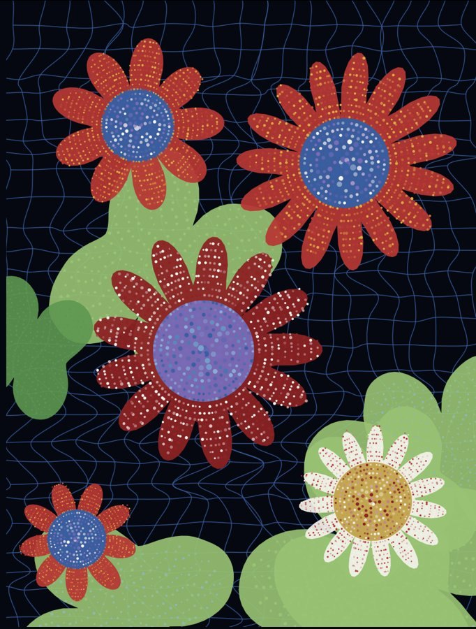
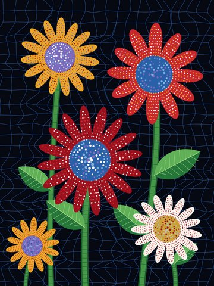
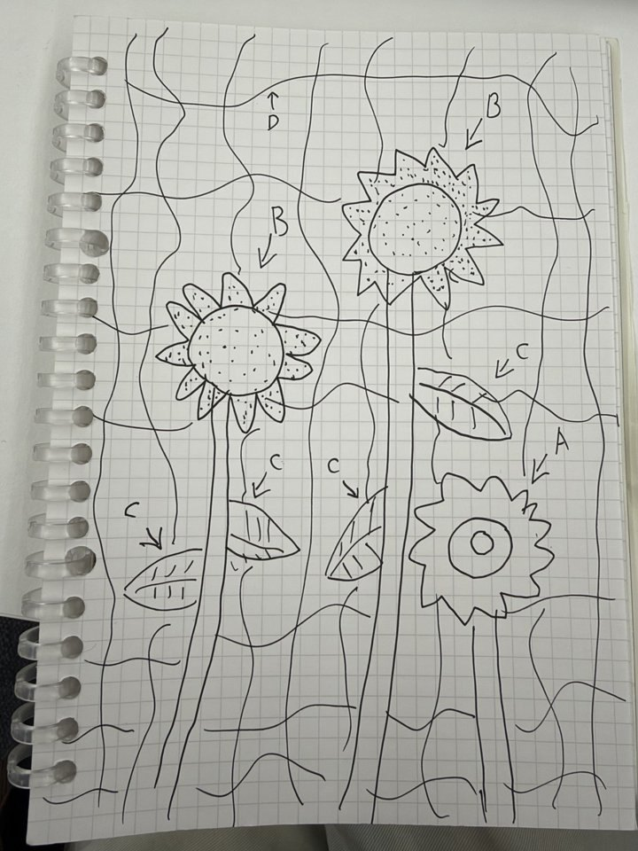
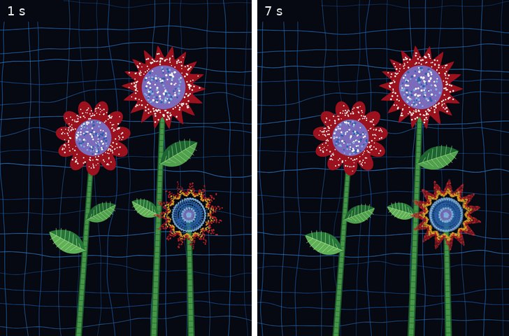
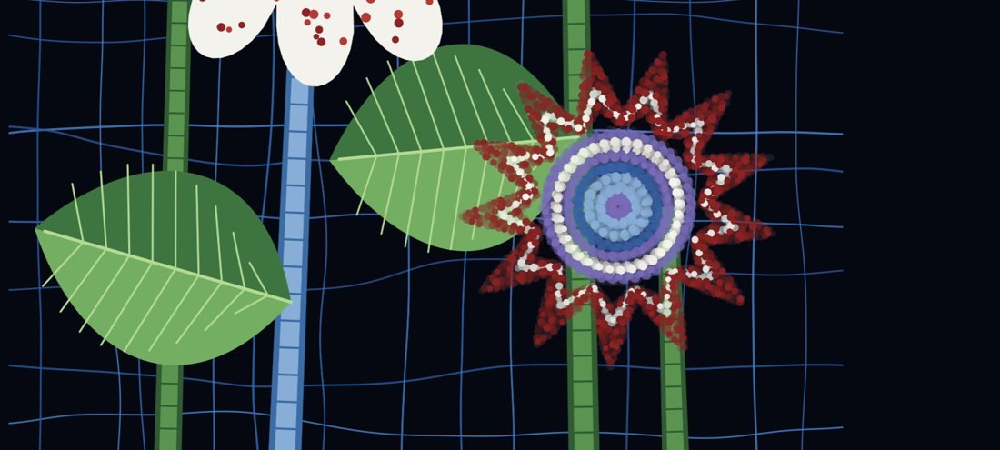
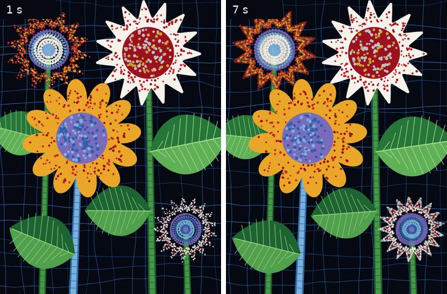
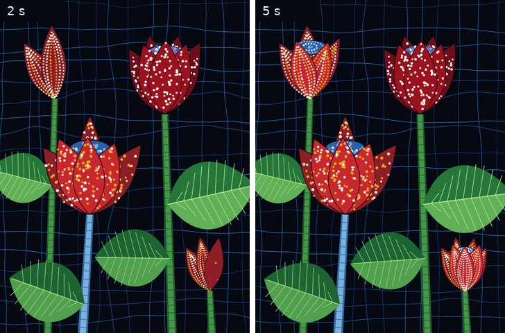
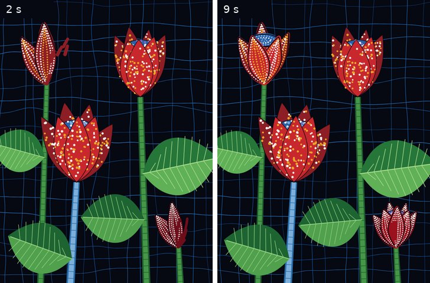
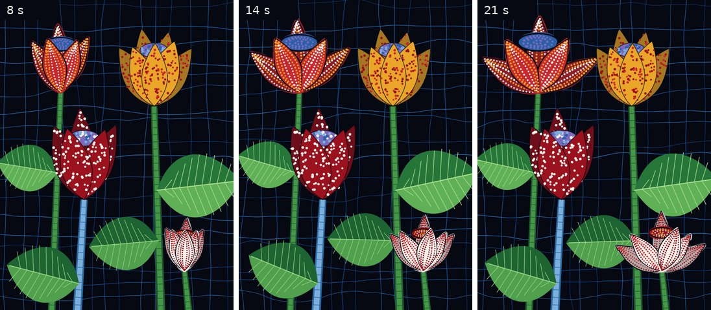
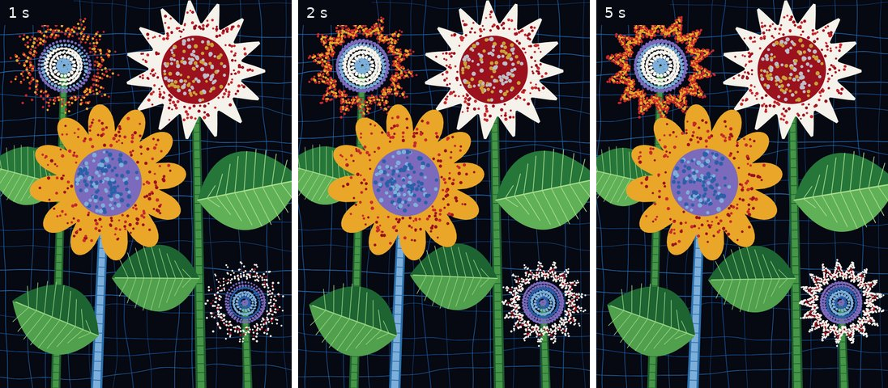

# Iterations: Perlin noise and randomness mechanic

**Mechanic owner:** Jackie · `perlin-layer.js` (with `plants.js` and `sketch.js`)

My mechanic went through eight working versions, from a first noise-shaped flower to the final self-drawing flower that hands over to the time mechanic. The rule stayed the same throughout: `random()` decides what each thing is like, once per refresh, and `noise()` decides how it moves, every frame. What changed was which shapes, dots and motions those two jobs were applied to.

This file covers my mechanic only. The time, audio and user-input mechanics are documented by their owners in the README.

## Summary

| Version | Date | What changed | Why |
|---|---|---|---|
| [1.0](#version-10-first-prototype) | 25 Sep | Noise-shaped spiky flowers and leaves, dots in rings drifting between two colours, a wandering background net | Turn my concept into code: noise for smooth forms, random for the details |
| [1.1](#version-11-flowing-rings) | 25 Sep | Rings of dots rotate; static stems and leaves in `plants.js`; new colours on every refresh | I wanted flowing dots, real-looking plants and a new colouring each refresh |
| [2.0](#version-20-the-abcd-structure) | 25 Sep | Rebuilt around my concept sketch: A self-drawing flower, B dotted flower, C wind leaves, D Perlin lines | Give each part its own technique, using the Week 8 patterns |
| [2.1](#version-21-four-flowers) | 25 Sep | Two A and two B flowers laid out like the painting, large leaves, blue stem | Closer to the painting. Week 9 presentation version and first GitHub upload (9 Oct, `9a1ad69`) |
| [3.0](#version-30-flower-buds) | 16 Oct | A and B became closed buds; A's pens stop once the bud is drawn | Try a calmer form that finishes instead of looping |
| [3.1](#version-31-buds-drawn-by-dots) | 16 Oct | A's bud built entirely from dots: base, outline and accent passes | Everything in A should come from the dot animator |
| [4.0](#version-40-the-bud-blooms) | 16 Oct | After drawing, each bud opens over 12 seconds with its dots scaling with the petals | Explore movement after the drawing finishes |
| [5.0](#version-50-back-to-the-open-flower-final) | 16 Oct, pushed 22 Oct | Back to the 2.1 open flowers; pens stop after 4 laps, every dot is recorded, `onCreated` fires | Keep the original look and give the time mechanic a clean hook (`b28bcaf`, `90e1574`) |
| [5.1](#version-51-comments-and-documentation) | 23 Oct | Comments and AI acknowledgement in `perlin-layer.js`; no code change | Meet the brief's documentation requirements |

All preview images were rendered from each version's code with the same random seed.

---

## Starting point

I chose **Perlin noise and randomness**: "Utilise Perlin noise AND random values or random seed to drive your mechanic." The source artwork is a Yayoi Kusama sunflower painting: dotted flowers and large leaves on a dark background crossed by a blue net.

My first idea was to use Perlin noise to draw smooth flower and leaf shapes, randomness to generate the dots inside them with changing colours, and a solid midnight background. Before building, I made these decisions:

- The painted petals are sharp, not smooth, so noise only *modulates* a pointed spike shape. Pure noise makes blobs.
- The painted dots follow rings, so polar maths sets the rings and randomness adds the variation (size, angle offset, colour).
- Colours come from a palette sampled from the painting, not `random(255)`.
- Colours change slowly and never flicker every frame.

---

## Version 1.0: first prototype

*25 Sep.* My first working version drew everything with one technique: noise-shaped forms filled with rings of dots.

- **Flowers:** a spike shape, `pow(abs(cos(…)), sharpness)`, with noise wobbling the radius by ±12% and the whole bloom slowly breathing.
- **Dots:** concentric rings laid out with polar maths. `random()` sets each ring's offset and each dot's angle jitter, size and two colours; noise slides each dot between its two colours.
- **Leaves:** a noise-rippled oval filled with dot rings, swaying on noise. Seven leaves placed at random.
- **Background:** a net built on an irregular random grid, every point wandering on noise.
- `randomSeed(7)` fixed the composition; the canvas was a fixed 900 × 1200 px.

## Version 1.1: flowing rings

*25 Sep.* I kept the background and flowers, but wanted real stems and leaves without noise, dots that flow around their ring, and new colours on every refresh.

- **Flowing rings:** a new `Ring` class rotates each ring of dots. `random()` picks its direction and speed; noise makes the speed surge and slow (0.1–2×). Petal dots only show while inside a petal, so they stream through the petals.
- **Colour on refresh:** each dot gets one random colour per page load, and the fixed seed was removed.
- **New `plants.js`:** static stems and two-tone leaves drawn with bézier curves, with no noise and no randomness.

**What I learned:** every part used the same technique, so I drew a concept sketch to give each part its own job.

---

## Concept sketch

| Part | My plan |
|---|---|
| A · flower | Drawn by a dot animator; the stem is a plain shape |
| B · flower | A solid shape whose dots move inside it with the randomNoisyShape pattern |
| C · leaf | Moves up and down with Perlin noise, as if blown by wind |
| D · background | Perlin lines replace Kusama's painted net, in the painting's colours |

## Version 2.0: the A/B/C/D structure

*25 Sep.* I rebuilt the mechanic around the sketch, applying two Week 8 patterns. Every later version kept this structure.

| Part | Class | `random()` decides | `noise()` drives |
|---|---|---|---|
| A | `FlowerDotAnimator` with 12 `DotPen`s (extends the Week 8 DotAnimator) | Petal count, colours, each pen's start angle and direction | Each pen's path wobble (±0.05) and dot size (0.6–1.3×) |
| B | `NoisyFlower` with 290 `NoisyDot`s (Week 8 randomNoisyShape) | Each dot's home, colour, size, `noiseLocation`, `noiseScale` | Each dot's drift around its home (x, and x + 10 for y) |
| C | `WindLeaf` | Leaf width, colour set, flutter seed and amount | One shared wind for all leaves, plus each leaf's own flutter |
| D | `PerlinBackground` | Each line's position nudge, seed, amplitude, colour, weight | The wave along each line, slowly changing over time (2D noise) |

- A draws onto its own `createGraphics()` layer, because the background redraws every frame. The layer fades slowly, so A keeps drawing forever.
- `keepInside()` keeps B's dots between the core edge and the petal edge.
- Both flower types share one `petalOutline()` function with "spiky" and "round" styles.
- Week 8 normalised coordinates: every position is a fraction of the canvas, and `windowResized()` rescales a 3:4 canvas.
- **Bug fixed:** a round flower's core could bulge past its petal dips, so the core is now sized from the dips: `coreRatio = inner × random(0.72, 0.8)`.

## Version 2.1: four flowers

*25 Sep.* I laid the flowers out like the painting.

- Two A flowers (top-left, bottom-right) and two B flowers (spiky top-right; round middle-left, the largest, in front).
- Leaves 2–3× longer and broader, each with its own `tilt` so some droop. Longer leaves swing through a smaller angle.
- A blue stem, as in the painting.
- **Alignment fix:** the bottom-right flower sat over another stem, so I moved it right and made it smaller (radius 0.19 → 0.15).

This version went into my Week 9 presentation (8 Oct) and was my first upload to this repo (9 Oct, `9a1ad69`).

---

## Version 3.0: flower buds

*16 Oct.* I changed A and B into closed buds, and A's pens now stop once the bud is drawn instead of looping.

- **Shared bud shape, `makeBud()`:** `random()` picks 5–7 pointed petals (back and front), how open the bud is and the centre size. Parts are drawn back petals → centre → front petals.
- **New geometry:** petals are outlines of points (`petalPolygon`), `insidePolygon()` tests whether a point is inside a petal, and `PenPath` lets a pen walk along any outline at even spacing.
- **A:** each part gets its base colour, then its pens trace one lap of dots. After about 4 seconds everything stops.
- **B:** dots have random homes inside one petal or the centre (35 in the centre, 60 per petal) and never leave it.
- Thin dark outlines, and back petals shaded darker so the bud looks layered.

## Version 3.1: buds drawn by dots

*16 Oct.* Nothing in A is filled in any more; each part is built in three passes of dots:

1. **Base:** six contours of big, overlapping dots in the petal colour.
2. **Outline:** a fast ring of small dark dots on the edge.
3. **Accent:** three contours of Kusama dots in random accent colours.

The bud takes about 7.5 seconds, then stays as drawn.

## Version 4.0: the bud blooms

*16 Oct.* Once an A bud is drawn, it opens over 12 seconds, and the dots inside each petal stay exactly the same.

- Every petal and the centre is drawn on its own small `createGraphics()` layer (2× resolution). After drawing, each layer is turned and scaled as one picture.
- Petals hinge at the bud's base and grow 1.12×; the centre grows 1.3× and lifts slightly.
- `BLOOM_SECONDS = 12` with smooth easing. `random()` gives each part a 0–2.5 s delay so the petals don't move in sync; noise makes open petals sway (±0.05 rad).
- **Fix:** at first one back petal stayed upright and the centre floated like a lid, so the back petals now fan out evenly and the centre lifts less.

---

## Version 5.0: back to the open flower (final)

*16 Oct, pushed 22 Oct (`b28bcaf`, `90e1574`).* I returned to the open flowers of version 2.1, but A now finishes its drawing and announces it. This is the point where the time mechanic takes over.

- **Same look as 2.1:** open spiky and round flowers, layout, stems, leaves and background.
- **Pens finish:** `DRAW_LAPS = 4`. Each `DotPen` counts how far it has turned and stops after four full laps, one dot per frame (about 5 seconds).
- **Every dot is recorded** in the flower's `dots` list: position in radius units, size and colour. About 1,900 dots per flower.
- **Resize without restarting:** `resetLayer()` repaints the recorded dots at the new size.
- **`onCreated` event:** when every pen is done, the flower frees its layer and calls `onCreated`, an empty slot that `sketch.js` fills. Another mechanic can react without the files depending on each other.

## Version 5.1: comments and documentation

*23 Oct.* No code change. I added comments to `perlin-layer.js`: a header naming the mechanic, its four parts, the AI acknowledgement and the Week 8 reference, plus a `RANDOM —` or `NOISE —` label at every use of `random()` and `noise()`.

---

## How `random()` and `noise()` changed

| Version | `random()` decides (once per refresh) | `noise()` drives (every frame) |
|---|---|---|
| 1.0 | Petal count, sharpness, core size, colour scheme, ring offsets, dot jitter and colour pairs, leaf placement, net spacing (seed fixed at 7) | Petal and leaf outlines, breathing, dot colour drift and pulse, leaf sway, net wander |
| 1.1 | As 1.0, plus each ring's direction and speed and each dot's single colour; no fixed seed | Ring speed surging and slowing, dot pulse, outlines, net wander |
| 2.0–2.1 | Pen start angle and direction, dot homes, `noiseLocation` and `noiseScale`, leaf width and colours, line positions | Pen wobble and dot size, dot drift, shared wind plus flutter, 2D line waves |
| 3.0–3.1 | Bud petal count (5–7), how open it is, centre size, accent colours | Pen wobble and dot drift, both kept inside each petal |
| 4.0 | A start delay for each petal's bloom | Each petal's sway once open |
| 5.0 | As 2.1 | As 2.1; the pens now stop after four laps |

## What I learned

- **Random seeds feed noise.** Every `random(1000)` seed (`distortSeed`, `noiseLocation`, `flutterSeed`, `seed`) is a starting place in the noise field. Without it, every object would move in lockstep.
- **A curated palette beats `random(255)`.** Random choices from colours sampled from the painting keep every refresh recognisably Kusama.
- **Movement needs limits.** `keepInside()` and `insidePolygon()` stop noise from pushing dots out of their petals.
- **The background affects the drawing technique.** Because D redraws every frame, A has to draw onto its own `createGraphics()` layer.
- **Build for the team.** Keeping the mechanic in its own file and adding the `onCreated` event let the time mechanic plug in without changing my file.

---

*AI acknowledgement: parts of the code described here, and this write-up, were produced with the help of Claude (Anthropic) and then edited by me. The DotAnimator and randomNoisyShape patterns come from the IDEA9103 Week 8 tutorial.*
